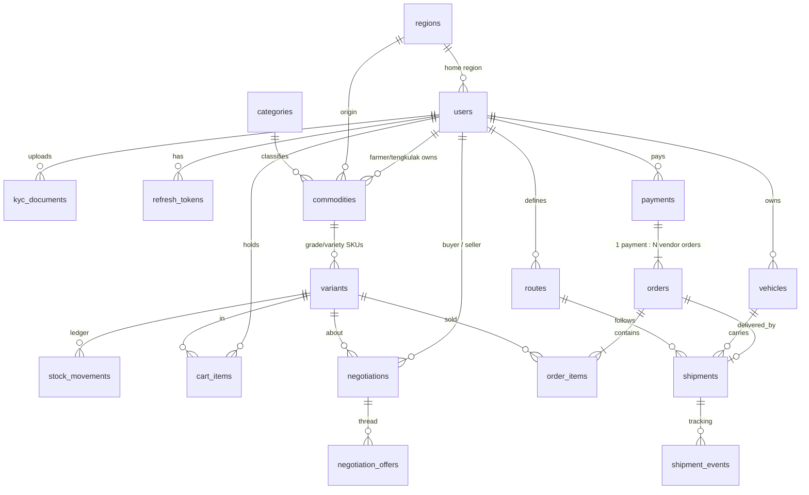

# Rumah Tani — ERD & Design Notes

## Race-condition strategy (stock)
1. `variants` has `CHECK (stock_qty >= 0)`, `CHECK (reserved_qty >= 0)`, `CHECK (reserved_qty <= stock_qty)` — the database itself refuses oversell.
2. Checkout runs in one transaction: `SELECT … FROM variants WHERE id = ANY(cart) ORDER BY id FOR UPDATE` (consistent lock order ⇒ no deadlocks), re-validates availability *after* locking, then increments `reserved_qty`.
3. Payment `paid` webhook converts reserved → sold; `expired/failed` (or the 60 s expiry job) releases the reservation. Webhook is idempotent (`payments … FOR UPDATE` + status check) and verifies signature and amount.
4. Stock edits by farmers are **delta-based** under row lock, plus an append-only `stock_movements` ledger.
5. Transactions auto-retry on `40001/40P01`.

## RBAC
Guest = no token (read-only `/public/*`). Roles enforced by `requireRole()`; tengkulak additionally scoped by `region_id`; KYC gate via `requireKyc`. Frontend adds edge middleware + `<RoleGuard>` (UX only; API is the source of truth).
